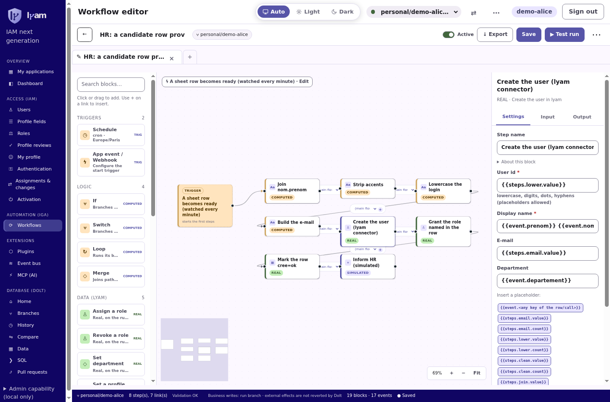
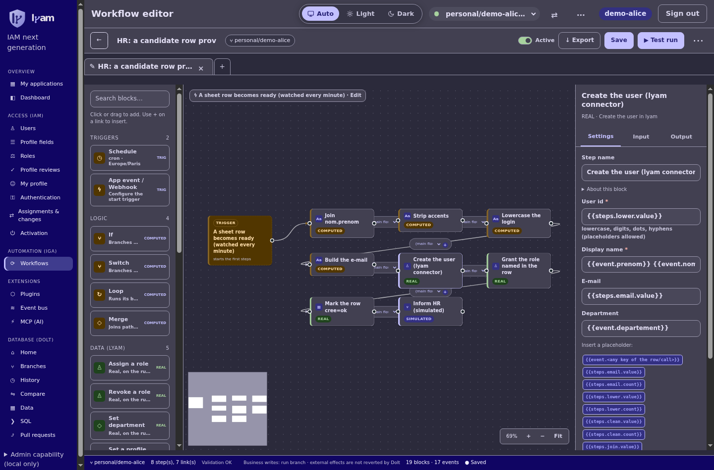
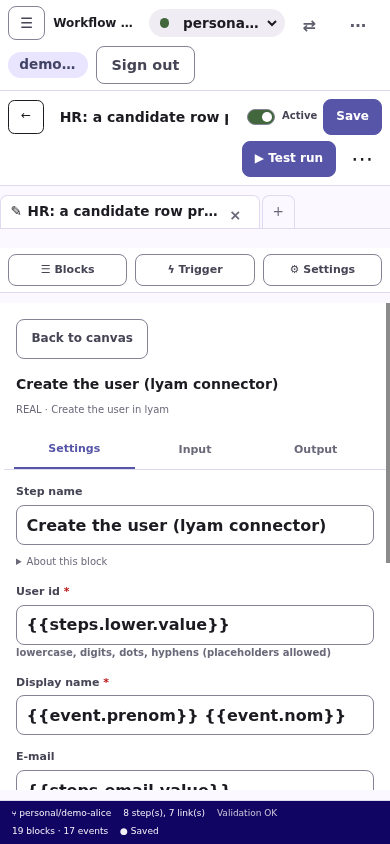
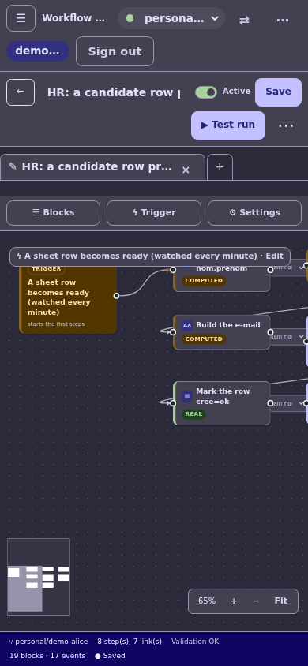

# Workflow editor: Direction C

The editor now owns the available viewport. Palette and inspector scroll independently; the canvas no longer sits in a fixed-height card. Secondary actions remain available in the workflow menu. Existing global session, theme and data-branch controls are preserved.

## Implemented

- Compact toolbar, searchable palette groups with counts, block icons and existing category badges.
- Dotted canvas, bottom-left mini-map, bottom-right zoom percentage and Fit.
- Trigger settings in the inspector, Settings / Input / Output, and an explicit error-route selector backed by the existing graph edges.
- Unsaved indicator in the open tab and status bar. An edit made while saving remains unsaved.
- Floating test panel with measured run duration/progress. No success marker is shown without a reported step result.
- Mobile Blocks / Trigger / Settings panels, with click-to-add as an alternative to dragging.

The Test panel warns that external connectors can make real calls. A disposable data branch does not roll back external effects. This change does not add connection storage, global simulation enforcement, SQL blocks, table watchers or write-row blocks.

## Reproduce the local browser checks

Build the API and run the existing plugin setup, then build the web app in development mode (the check uses Angular's debug API to initialize an isolated test session).

```sh
(cd apps/api && npm run build)
node scripts/plugin-dev-setup.mjs
(cd apps/web && npx ng build --configuration development)
CHROME_BIN=/path/to/chrome node scripts/workflow-workbench-ui-check.mjs /tmp/workflow-shots
```

The check runs real Angular components in Chrome at 1440 and 390 pixels, with the repository's seed workflow and block/event catalogues served as local API fixtures. It checks overflow, trigger configuration, inspector tabs, secondary tools, the test safety warning, click-to-add, unsaved state, undo and full-graph mobile Fit. It does **not** exercise a live backend or Google/Jira accounts. Backend workflow, trigger and connector integration tests are separate.

## Captures

All captures below use seed data and the local fixture server, not a hosted preview.

| Desktop light | Desktop dark |
| --- | --- |
|  |  |

| Mobile settings | Mobile canvas |
| --- | --- |
|  |  |
